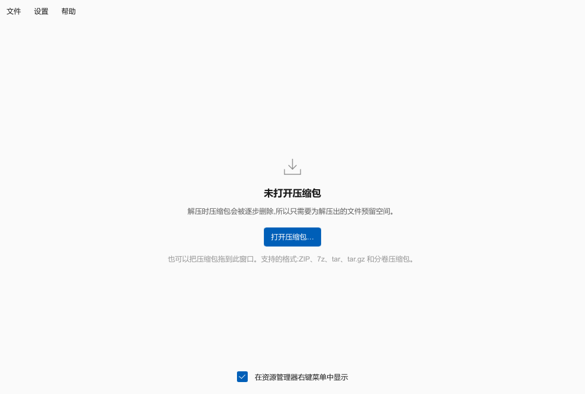
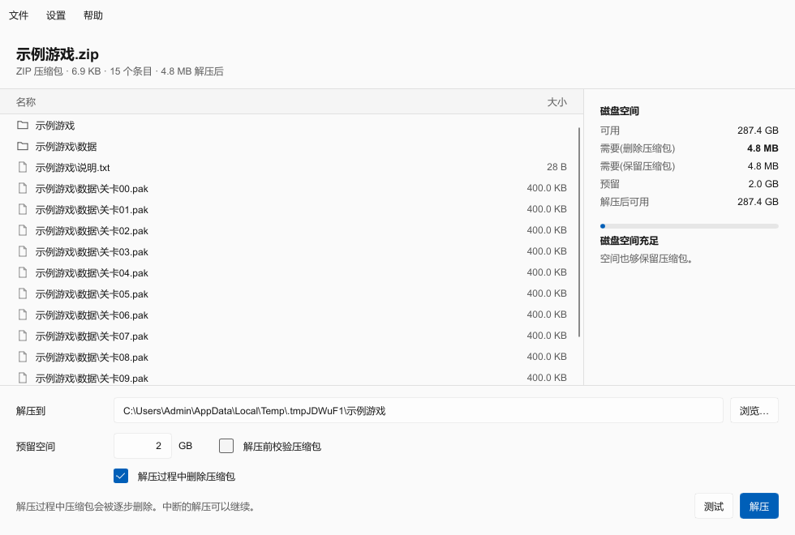

# HatchZip 中文版

> 本项目是 [xevrion/hatchzip](https://github.com/xevrion/hatchzip) 的**非官方汉化分支**,基于上游 v0.1.3。功能和提取引擎与上游一致,增加了完整的简体中文界面、命令行中文输出、中文右键菜单,以及可随时切换的中英文语言设置。原版英文说明见 [README.upstream.md](README.upstream.md)。

HatchZip 用来**就地解压超大压缩包**:它从压缩包末尾开始解压,每解完一部分就把这部分从压缩包文件中截断,释放出的空间供后续文件使用。所以只需要为解压出的文件预留空间,不需要同时容纳文件和压缩包。


## 截图

| 空状态 | 打开压缩包 |
|---|---|
|  |  |

## 与原版的区别

- **图形界面全中文**:菜单、按钮、空状态、条目表、磁盘空间面板、进度与结果文字、任务窗口、关于窗口、密码框。
- **命令行全中文**:`--help` 全文、参数说明、空间计划、进度条、错误与汇总、man 手册、补全脚本。
- **右键菜单中文**:解压到当前文件夹、解压到当前文件夹(保留压缩包)、解压到新文件夹、测试压缩包。
- **中英文可切换**:主窗口菜单「设置 → 语言 → English / 中文」,切换即时生效并记住选择。
- 命令行跟随同一个语言设置;临时覆盖可用环境变量 `HATCHZIP_LANG=en` 或 `HATCHZIP_LANG=zh`。
- 引擎内部的技术性错误详情保留英文原文,便于排查问题。

## 下载与安装

到 [Releases](https://github.com/lzzybell/hatchzip-zh/releases) 页面下载 `hatchzip-zh-0.1.3-windows-x64.zip`,解压到任意目录即可:

```text
hatchzip.exe        命令行
hz.exe              命令行的短名字
hatchzip-gui.exe    桌面程序
LICENSE-*.txt       许可证
```

把解压目录加入 `PATH` 后,新开的终端就能直接运行 `hatchzip` 和 `hz`。

在资源管理器右键菜单里注册(每个压缩包类型):

```powershell
.\hatchzip-gui.exe --register-shell
```

移除:

```powershell
.\hatchzip-gui.exe --unregister-shell
```

也可以直接覆盖官方安装目录里的同名文件,例如把 `hatchzip.exe`、`hatchzip-gui.exe`、`hz.exe` 复制到 `D:\HatchZip\`。

## 语言切换

- 桌面程序:菜单 **设置 → 语言 → English / 中文**,立即生效。
- 选择保存在 `%APPDATA%\HatchZip\settings.json` 的 `lang` 字段。
- 命令行读取同一个设置;也可以临时用 `HATCHZIP_LANG` 覆盖。
- 没有设置时跟随 Windows 显示语言。

## 用法

和原版一致(见 [README.upstream.md](README.upstream.md)):

```powershell
hatchzip check 游戏.zip                # 只看空间计划,不改动任何东西
hatchzip extract 游戏.zip              # 解压到 .\游戏,解压过程中删除 游戏.zip
hatchzip extract 游戏.zip --keep-archive   # 解压并保留压缩包
hatchzip x 游戏.7z.001 -o D:\Games     # 分卷压缩包,任意一卷都可以
hatchzip test 游戏.7z                  # 只校验,不写文件
```

## 从源码构建

需要 Rust 1.95(仓库用 `rust-toolchain.toml` 锁定)和 C++ 编译器(启用 RAR 支持时):

```powershell
git clone https://github.com/lzzybell/hatchzip-zh.git
cd hatchzip-zh
cargo build --release -p hatchzip -p hatchzip-gui --features hatchzip/rar,hatchzip-gui/rar
```

产物是 `target/release/hatchzip.exe` 和 `target/release/hatchzip-gui.exe`。

## 项目结构

在上游基础上新增:

- `crates/i18n`:中英文案表与语言状态,约 200 条文案。
- `crates/gui/ui/i18n.slint`:界面字符串全局,由 Rust 在启动和切换语言时注入。
- `crates/cli/src/cli.rs`:`clap` 命令的本地化,以及帮助标题的中文替换。

## 许可证与出处

- 本项目与上游一样以 **MIT OR Apache-2.0** 双许可证发布,详见 [LICENSE-MIT](LICENSE-MIT)、[LICENSE-APACHE](LICENSE-APACHE)。
- 原始项目:[xevrion/hatchzip](https://github.com/xevrion/hatchzip),作者 Yash Bavadiya,基于上游 commit `dd4f52f`(v0.1.3)。修改说明见 [NOTICE.md](NOTICE.md)。
- RAR 支持通过 UnRAR 源码实现,受其自身许可证约束,详见 [LICENSE-UNRAR](LICENSE-UNRAR)。

## 免责声明

这是社区汉化分支,不是官方版本。上游作者与 hatchzip.dev 与本仓库无关。压缩包会被逐段删除,请先用 `hatchzip check` 或 `--keep-archive` 确认空间和行为。
